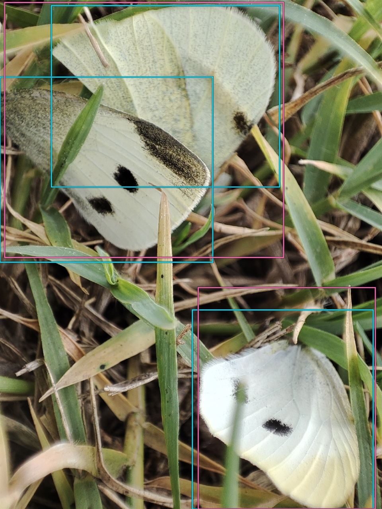
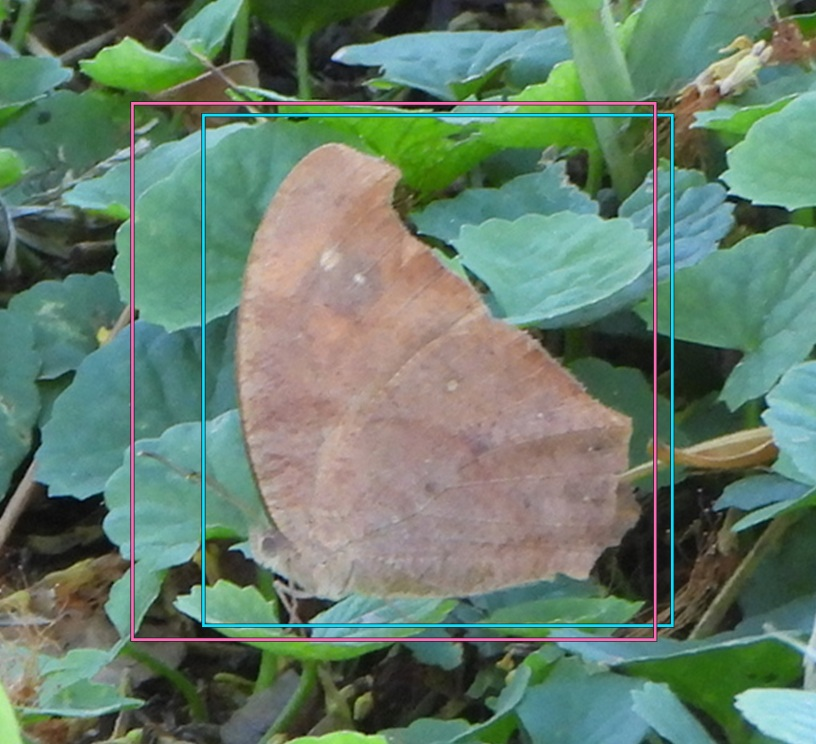

# Разметка и ревью

В [проекте разметки](https://tasks.yandex.ru/requester/project/11970) исполнитель обводил каждую взрослую бабочку. В [проекте ревью](https://tasks.yandex.ru/requester/project/11969) другой человек проверял пропуски, лишние рамки и границы. В основных пулах работали 6 разметчиков и 14 ревьюеров, составы не пересекались. [Инструкции с примерами](tasks/instructions.html) · [Исходные ответы и вердикты](answers/)

## Допуск и контроль

- **Обучение.** Чтобы перейти к экзамену, и разметчикам, и ревьюерам нужно было правильно выполнить не менее 9 из 10 учебных заданий (90%). Разметчики обводили бабочек. Ответ засчитывался, если каждой бабочке соответствовала одна рамка с IoU ≥ 0,70 относительно эталона и лишних рамок не было. Ревьюеры решали, принять ли предложенную разметку. При ошибке исполнитель получал подсказку по конкретному фото, например, какую сторону рамки подвинуть, чтобы в неё попали усики. [Обучение разметчиков](https://tasks.yandex.ru/requester/project/11970/training/6875558) · [обучение ревьюеров](https://tasks.yandex.ru/requester/project/11969/training/6875561)
- **Экзамен.** Для допуска к работе требовалось правильно выполнить не менее 9 из 10 заданий. У разметчиков порог совпадения рамок на экзамене составлял IoU ≥ 0,60. [Экзамен разметчиков](tasks/exam_bbox.tsv) · [экзамен ревьюеров](tasks/exam_review.tsv)
- На полной рабочей странице было 4 основных фото и 1 скрытое. За полную страницу разметчик получал 1,50 ₽, ревьюер - 0,75 ₽. По нашим расчётам, при 10 секундах на разметку одного фото и 5 секундах на его проверку это около 108 ₽ в час для каждой роли. При двух ошибках среди последних десяти контрольных ответов исполнитель терял доступ к новым страницам. [Настройки пула разметчиков](https://tasks.yandex.ru/requester/project/11970/pool/6876274) · [настройки пула ревьюеров](https://tasks.yandex.ru/requester/project/11969/pool/6876275)
- На скрытом фото каждой эталонной рамке должна соответствовать одна рамка с IoU ≥ 0,60. Пропуск или лишняя рамка считаются ошибкой. Ревьюеру показывали готовую разметку и сверяли его вердикт с ключом. [100 контрольных примеров с ответами для обеих ролей](tasks/keys_100.jsonl) · [проверка рамок в интерфейсе](tasks/bbox_project_iou.js)

### Результаты контроля

| Роль | Ошибки на основном экзамене | Ошибки на скрытых заданиях в работе | Потеряли доступ к новым страницам |
|---|---:|---:|---:|
| Разметчики | 1 из 60 | [3 из 130](answers/bbox.tsv) | 1 из 6 |
| Ревьюеры | 2 из 150 | [5 из 398](answers/review.tsv) | 2 из 14 |

## Исправления

| Раунд | Что проверили | Решение |
|---|---|---|
| 1 | 400 разметок, по три ревью | 330 приняли единогласно, 70 отправили на переразметку |
| 2 | 70 новых разметок, по три ревью | 56 приняли единогласно, по 14 остались замечания |
| 3 | Для 14 фото получили по три разметки, по четыре ревью на вариант | После просмотра для 9 фото оставили единогласно одобренный вариант, для 5 команда выбрала вариант вручную |

Вот два из пяти кадров, для которых команда выбрала разметку вручную. На обоих фото в варианте A рамок нет. Голубым показаны рамки варианта B, розовым - варианта C.

**Пропущенные бабочки.** На [фото 759487062](../data/images/759487062.jpg) три бабочки. В первых двух раундах разметчики не обвели ни одной. В третьем раунде в варианте C одна рамка охватила сразу двух бабочек. Команда выбрала B, где у каждой бабочки своя рамка.

**Обрезанный усик.** На [фото 759563419](759563419_variants.jpg) все четыре ревьюера одобрили вариант B. На увеличении видно, что кончик усика выходит за левую границу голубой рамки. Команда выбрала вариант C, где усик целиком попадает в розовую рамку.

В [журнале исправлений](selection.tsv) для каждого фото указаны выбранная разметка и число одобрений. Для отправленных на переразметку фото приведены замечания ревьюеров. Идентификаторы `source_task_id` и `source_assignment_id` ведут к исходному ответу разметчика, `annotation_id` - к вердиктам.

## Расходы

Из 850 ₽ потратили **845,25 ₽**, включая комиссию. Пилот стоил 21 ₽, экзамены пилота - 84 ₽, основные экзамены - 55,65 ₽. Три рабочих раунда стоили 525 ₽, 92,40 ₽ и 67,20 ₽ соответственно. [Выплаты разметчикам, ревьюерам и комиссия по этапам](budget.tsv)
